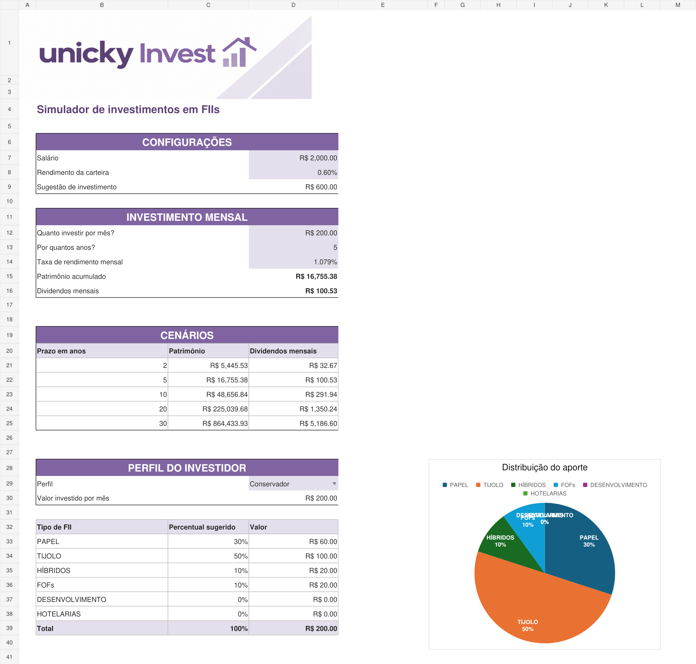
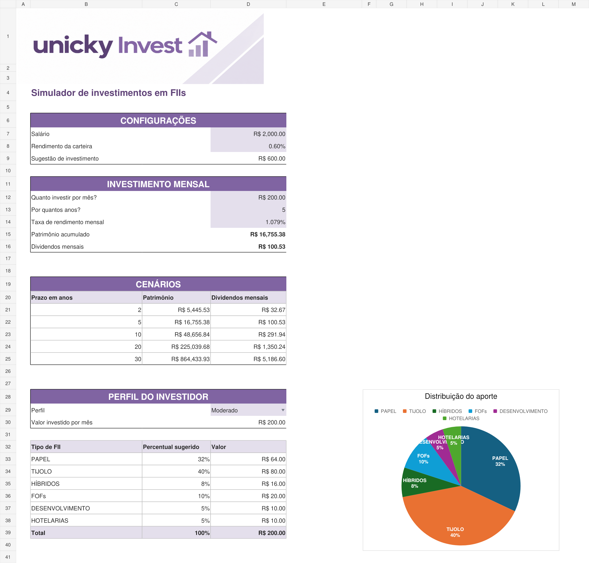

# unicky Invest

Simulador de investimentos em fundos imobiliários desenvolvido em Excel para o desafio de projeto do curso da **DIO**.

## Perguntas que a ferramenta responde

| Pergunta | Onde aparece a resposta na aba Investimentos |
| --- | --- |
| Quanto investir por mês como sugestão com base no salário? | Sugestão de investimento: D9 |
| Quanto acumular com o aporte, prazo e taxa informados? | Patrimônio acumulado: D15 |
| Quanto esse patrimônio pode gerar de dividendos mensais? | Dividendos mensais: D16 |
| Qual a projeção para 2, 5, 10, 20 e 30 anos? | Cenários: B21:D25 |
| Como dividir o aporte entre os tipos de FII conforme o perfil? | Distribuição: B33:D38 e gráfico de pizza |

O aporte mensal é preenchido em D12 e pode ser diferente da sugestão calculada a partir do salário.

## Como o VF entra nos cálculos

```excel
=VF(taxa_mensal;qtd_anos*12;-aporte)
```

O VF calcula o patrimônio futuro. A taxa é mensal, por isso o prazo em anos é multiplicado por 12. O aporte entra negativo porque representa uma saída de dinheiro para o investimento. A fórmula considera saldo inicial zero e aportes no fim de cada mês.

Nos cenários, o prazo muda e o aporte e a taxa permanecem iguais. Os dividendos mensais estimados são calculados com `=patrimonio*rendimento_carteira`. A sugestão de aporte é `=salario*30%`.

## Como o PROCV entra nos cálculos

Na aba Tabela de apoio, a chave composta junta perfil e tipo de fundo:

```excel
=C4&"-"&D4
```

Exemplo: `Conservador-PAPEL`. Assim, o mesmo tipo de fundo pode ter percentuais diferentes para cada perfil.

Na aba principal:

```excel
=PROCV($D$29&"-"&B33;'Tabela de apoio'!$B$4:$E$21;4;FALSO)
```

O PROCV busca a chave na primeira coluna do intervalo e retorna o percentual da quarta coluna. `FALSO` exige correspondência exata. `$D$29` mantém o perfil fixo ao copiar a fórmula para as outras linhas.

O valor por tipo de fundo é calculado com `=C33*$D$30`, multiplicando o percentual pelo aporte mensal.

## Intervalos nomeados

| Nome | Célula na aba Investimentos | Conteúdo |
| --- | --- | --- |
| salario | D7 | Salário de exemplo |
| rendimento_carteira | D8 | Taxa mensal para estimar dividendos |
| sugestao_investimento | D9 | Sugestão de aporte |
| aporte | D12 | Aporte mensal |
| qtd_anos | D13 | Prazo em anos |
| taxa_mensal | D14 | Taxa mensal utilizada no VF |
| patrimonio | D15 | Patrimônio acumulado |

Os nomes deixam as fórmulas mais fáceis de ler.

## Percentuais dos perfis e origem

| Tipo de FII | Conservador | Moderado | Agressivo |
| --- | --- | --- | --- |
| Papel | 30% | 32% | 50% |
| Tijolo | 50% | 40% | 10% |
| Híbridos | 10% | 8% | 5% |
| FOFs | 10% | 10% | 5% |
| Desenvolvimento | 0% | 5% | 20% |
| Hotelarias | 0% | 5% | 10% |
| **Total** | **100%** | **100%** | **100%** |

Mantive os percentuais da tabela de apoio da minha primeira planilha, montada durante o exercício. São exemplos didáticos e não uma recomendação de investimento.

## Personalização em relação à proposta do Expert

Mantive a proposta de cálculo apresentada no exercício e personalizei a ferramenta com o nome **unicky Invest**, cores em roxo e lilás e um gráfico de pizza da distribuição do aporte.

Na revisão da minha primeira versão, também deixei todas as chaves da tabela de apoio e todos os valores de distribuição com fórmulas, para acompanhar mudanças no aporte e no perfil.

## Evidências de funcionamento

As imagens usam a mesma simulação, alterando apenas o perfil:

- Salário de exemplo: R$ 2.000,00.
- Aporte mensal: R$ 200,00.
- Prazo: 5 anos.
- Taxa de rendimento mensal: 1,079%.
- Taxa mensal para estimar dividendos: 0,6%.

O patrimônio é de **R$ 16.755,38**, com dividendos mensais estimados de **R$ 100,53**. A mudança de perfil altera a distribuição e o gráfico. O patrimônio permanece igual porque o modelo usa a mesma taxa de rendimento para todos os perfis.

### Conservador



### Moderado



| Tipo de FII | Aporte Conservador | Aporte Moderado |
| --- | --- | --- |
| Papel | R$ 60,00 | R$ 64,00 |
| Tijolo | R$ 100,00 | R$ 80,00 |
| Híbridos | R$ 20,00 | R$ 16,00 |
| FOFs | R$ 20,00 | R$ 20,00 |
| Desenvolvimento | R$ 0,00 | R$ 10,00 |
| Hotelarias | R$ 0,00 | R$ 10,00 |
| **Total** | **R$ 200,00** | **R$ 200,00** |

## Como usar

1. Baixe [simulador_investimentos_fiis.xlsx](simulador_investimentos_fiis.xlsx) e abra no Excel.
2. Preencha os campos em lilás.
3. Escolha o perfil na lista de seleção.
4. Confira os resultados, os cenários e a distribuição do aporte.

## Verificações

Foram conferidos os três perfis, a soma de 100% dos percentuais e a soma dos valores distribuídos. Também foi testada a mudança do aporte de R$ 200 para R$ 300, verificando a atualização das fórmulas. O arquivo foi salvo com o perfil Moderado e os valores de exemplo usados nos prints.

## Aprendizados

Pratiquei VF, PROCV com chave composta, intervalos nomeados, referências absolutas e relativas, formatação e criação de gráfico de pizza.

Os valores publicados são exemplos. A simulação usa taxas constantes e rendimentos reinvestidos, sem incluir inflação, impostos ou custos.
